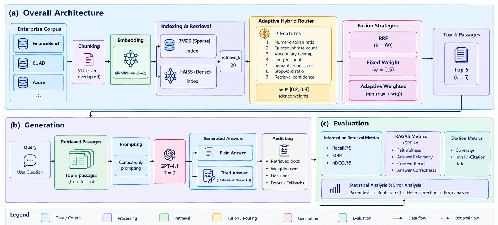
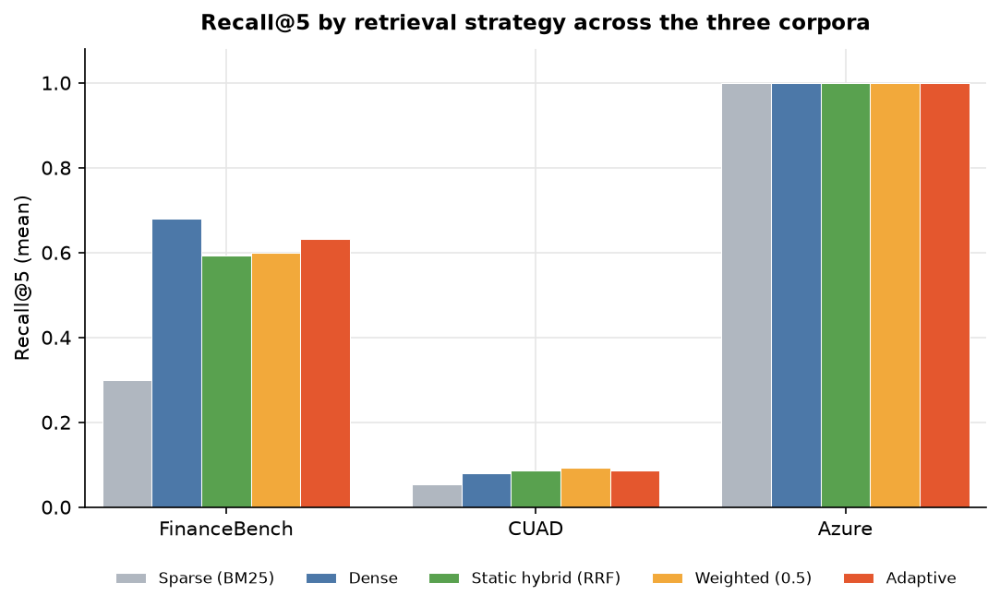

# Adaptive Hybrid RAG for Enterprise Question Answering

**Does smarter retrieval make an LLM more truthful?** This repository is a controlled, fully reproducible evaluation of sparse, dense, hybrid and query-adaptive retrieval, with and without inline citations, across financial filings, legal contracts and technical documentation.

It is the complete implementation, data and results behind my MSc dissertation at Loughborough University London (awarded Distinction):
*Towards Hallucination-Resilient Enterprise Question Answering: Evaluating an Adaptive Hybrid Retrieval-Augmented Generation Framework* ([PDF](docs/dissertation.pdf)).

   

---

## Key findings

| | Finding | Evidence (FinanceBench, n = 150, paired, Holm-corrected) |
|---|---|---|
| **1** | Hybrid retrieval rescues weak keyword search, but did not beat a strong dense retriever. | Recall@5 **0.30 → 0.59** vs BM25 (p < 0.001, d<sub>z</sub> = 0.62). Dense alone reached 0.68. |
| **2** | A transparent, untrained router improves *ranking* over a fixed-weight hybrid. | MRR **0.413 → 0.480**, nDCG@5 **0.493 → 0.560** (p ≈ 0.0004, d<sub>z</sub> ≈ 0.39). |
| **3** | Better ranking did **not** produce more faithful answers. | Faithfulness 0.756 → 0.814, not significant after correction (p = 0.24). |
| **4** | Inline citations are an auditability feature, not a hallucination fix. | 0% invalid citations on every corpus; no significant faithfulness change in any comparison. |

The headline result is the dissociation in 2 → 3. Retrieval gains are usually reported on their own; measuring retrieval and answer faithfulness in the same paired framework shows they do not move together. In the dense and hybrid configurations, unsupported synthesis (the right passage was retrieved, but the model over-reached) was about as common as retrieval failure. That points the next engineering effort at generation, not retrieval.

## Architecture



A corpus is chunked and indexed once (BM25 and a FAISS dense index). Each query is answered by one of eight configurations that differ only in how the two ranked lists are fused and whether citations are required. Every retrieval decision, prompt, answer, citation and routing decision is written to a per-question audit log.

### The eight configurations

| Configuration | Retrieval | Fusion | Citations | Research question |
|---|---|---|---|---|
| `sparse_bm25` | BM25 | — | No | RQ1 baseline |
| `dense` | all-MiniLM-L6-v2 + FAISS | — | No | RQ1 baseline |
| `static_hybrid` | BM25 + dense | RRF (k = 60) | No | RQ1 treatment, RQ2 base |
| `static_hybrid_cite` | BM25 + dense | RRF | Yes | RQ2 treatment |
| `static_hybrid_weighted` | BM25 + dense | Weighted, w = 0.5 | No | RQ3 baseline |
| `static_hybrid_weighted_cite` | BM25 + dense | Weighted, w = 0.5 | Yes | RQ3 baseline (cited) |
| `adaptive_hybrid` | BM25 + dense | Weighted, w per query | No | RQ3 treatment, RQ2 base |
| `adaptive_hybrid_cite` | BM25 + dense | Weighted, w per query | Yes | RQ3 / RQ2 treatment |

**Confound control.** The RQ3 baseline and treatment use the *identical* min–max weighted-fusion function and differ only in whether the dense weight is fixed (0.5) or chosen per query. Comparing an adaptive weighted hybrid against RRF would have mixed two changes (rank vs score fusion, and fixed vs adaptive weighting).

### The adaptive router

An untrained, fully auditable heuristic. For each query it computes seven features, combines them with fixed weights into a lexical and a semantic score, and maps the semantic fraction linearly onto a dense weight in **[0.2, 0.8]**:

| Feature | Pushes towards |
|---|---|
| Numeric-token ratio (+0.2 if "section", "clause", "table"…) | Lexical |
| Quoted-phrase count | Lexical |
| Vocabulary overlap with the corpus | Lexical (complement → semantic) |
| Query length (saturates at 20 tokens) | Semantic (complement → lexical) |
| Semantic cue words (why, how, explain, compare…) | Semantic |
| Stopword ratio | Semantic |
| Retrieval confidence (dense vs sparse top-1/top-2 margin) | Whichever retriever is more decisive |

No labelled routing data is needed and every decision can be reconstructed from the logged features. The router only helps where queries vary: it moved the weight between 0.40 and 0.71 on FinanceBench, but labelled 148 of 150 CUAD queries lexical and settled near 0.43.

## Results

### FinanceBench (150 questions over SEC filings)

| Configuration | Recall@5 | nDCG@5 | MRR | Faithfulness | Answer correctness |
|---|---|---|---|---|---|
| sparse_bm25 | 0.300 | 0.247 | 0.210 | 0.535 | 0.177 |
| dense | **0.680** | **0.570** | 0.475 | **0.837** | **0.344** |
| static_hybrid | 0.593 | 0.463 | 0.389 | 0.793 | 0.316 |
| static_hybrid_cite | 0.593 | 0.463 | 0.389 | 0.767 | 0.297 |
| static_hybrid_weighted | 0.600 | 0.493 | 0.413 | 0.756 | 0.299 |
| static_hybrid_weighted_cite | 0.600 | 0.493 | 0.413 | 0.800 | 0.304 |
| adaptive_hybrid | 0.633 | 0.560 | **0.480** | 0.814 | 0.310 |
| adaptive_hybrid_cite | 0.633 | 0.560 | **0.480** | 0.806 | 0.319 |



The three corpora fall into three regimes. FinanceBench separates the methods. CUAD sits near the floor (Recall@5 0.05–0.09) because its clause-extraction prompts never name the contract, so corpus-wide retrieval is near-impossible by construction. Azure sits at the ceiling (Recall@5 = 1.0 for every method). Full per-dataset means are in [`results/summary.csv`](results/summary.csv) and every paired test in [`results/stats.csv`](results/stats.csv).

### Research-question verdicts

| RQ | Question | Verdict |
|---|---|---|
| RQ1 | Does hybrid beat sparse-only and dense-only retrieval? | **Partially supported.** Significantly beats sparse; numerically below dense, not significant. |
| RQ2 | Do inline citations improve faithfulness and verifiability? | **Not supported** for faithfulness; **supported** for verifiability (0 invalid markers, coverage 0.43–0.81). |
| RQ3 | Does adaptive weighting beat a fixed weight? | **Partially supported.** Ranking improves on FinanceBench; answer quality does not change significantly. |

## Methodology at a glance

- **Generator:** GPT-4.1, temperature 0, identical across all configurations.
- **Judge:** RAGAS 0.2 with GPT-4o (a different model from the generator, to reduce self-preference bias): faithfulness, answer relevancy, context recall, answer correctness.
- **Retrieval metrics:** Recall@5, MRR, nDCG@5 at document level (Precision@5 and MAP@5 are also computed but are exact rescalings under single-gold labelling).
- **Citation metrics:** citation coverage and invalid-citation rate.
- **Statistics:** paired per question; Wilcoxon signed-rank (primary), paired t-test, Shapiro–Wilk, Cohen's d<sub>z</sub>, 10,000-sample bootstrap 95% CI, Holm–Bonferroni correction over 32 pre-specified comparisons per dataset.
- **Scale:** 8 configurations × 350 questions = **2,800 generated and judged answers**.
- **Indexing:** 512-token chunks with 64 overlap (tiktoken cl100k_base); candidate pool of 20 per retriever; top 5 passages to the generator.

## Quick start

```bash
git clone https://github.com/Peerarif5656/adaptive-hybrid-rag-enterprise-qa.git
cd adaptive-hybrid-rag-enterprise-qa
python -m pip install -r requirements.txt

# 1. Free: validate data and chunking (no API key needed)
python ahrag.py --datasets sample --dry-run

# 2. Free: regenerate every table, statistic and chart from the stored results
python ahrag.py --analyze-only
python supplementary_checks.py

# 3. Paid: a live smoke test (needs an OpenAI API key in .env, roughly $0.10)
cp .env.example .env            # then set OPENAI_API_KEY
python ahrag.py --datasets sample --limit 4

# 4. Paid: the full study (8 configs x 3 datasets, with RAGAS judging)
python ahrag.py --datasets financebench cuad azure
```

Useful flags: `--configs <name ...>` to run selected configurations, `--limit N` for the first N questions, `--no-ragas` to skip judging, `--build-data financebench cuad` to rebuild the public corpora from source.

Steps 1 and 2 need no API key and reproduce the published numbers exactly from the stored per-question results.

## Repository layout

```
ahrag.py                  Entire pipeline in one auditable module (numbered sections)
supplementary_checks.py   Re-derives the extra checks reported in the dissertation
requirements.txt          Pinned dependency versions
.env.example              Template for API keys (copy to .env; never commit .env)
data/
  financebench/           144 evidence documents, 150 questions
  cuad/                   102 contracts, 150 questions (seeded sample)
  azure/                  55 author-written docs, 50 hand-built questions
  sample/                 6 docs, 6 questions for a free smoke test
results/
  <dataset>/<config>.csv          Per-question metrics
  <dataset>/audit/<config>.jsonl  Full audit trace: prompt, retrieved chunks, answer, citations, routing
  summary.csv, stats.csv          Means and all paired statistical tests
  error_analysis*.csv             Low-faithfulness cases by error category
  supplementary_checks.txt        Output of supplementary_checks.py
  figures/                        Per-metric charts and the dissertation figures
docs/
  dissertation.pdf        The full dissertation
  architecture.png        Pipeline diagram
```

### Code map (`ahrag.py`)

| Section | What it does |
|---|---|
| §2 `chunk_document` | Token-window chunking |
| §3 `SentenceTransformerEmbedder` | Local dense embeddings, L2-normalised |
| §6–7 `BM25Retriever`, `DenseRetriever` | Sparse and FAISS dense retrieval |
| §8 `reciprocal_rank_fusion`, `weighted_fusion` | RRF and min–max weighted fusion |
| §10 `AdaptiveRetriever.route` | The seven-feature router |
| §11 `DISSERTATION_CONFIGS` | The eight configurations |
| §13–14 prompts, `citation_coverage` | Plain and cited prompts; citation metrics |
| §17 `recall_at_k`, `ndcg_at_k` … | IR metrics |
| §18 `evaluate_ragas` | RAGAS judging |
| §19 `paired_compare`, `holm_bonferroni` | Statistics |
| §21–22 `run_experiment`, `run_study` | Orchestration with resume support |
| §25 `run_analysis` | Summary, stats, error analysis, figures |

## Limitations

- **FinanceBench** uses the provided evidence passages rather than full filings, an open-book approximation that understates full-document retrieval difficulty.
- **CUAD** retrieval metrics are a stress test, not a fair comparison, because the prompts do not identify the contract.
- **Azure** is small and saturated; it is a robustness check only.
- **LLM judge:** faithfulness comes from one LLM judge from the same provider family as the generator, which scored refusals inconsistently (490 of 868 refusals scored 1.0, 344 scored 0.0). No human annotation was done.
- **Single models:** one generator and one dense encoder. all-MiniLM-L6-v2 truncates input beyond 256 word pieces, so longer chunks are embedded only in part.
- **No tuning:** the router weights were set a priori and compared against a fixed weight of 0.5, not a tuned fixed weight.

## Known implementation notes

These do not affect any reported result, but are worth knowing before reusing the code:

- `ndcg_at_k` credits every retrieved chunk of a gold document, so it can exceed 1. `supplementary_checks.py` reports a de-duplicated version; no verdict changes.
- The citation-mismatch rule in `error_analysis` lists only two of the three cited configurations. Since the invalid-citation rate was 0 everywhere, the output is unaffected.
- The optional Anthropic generator/judge classes need `anthropic` and `langchain-anthropic`, which are not in `requirements.txt`.
- Resume logic treats an existing per-config CSV as complete, so delete `results/<dataset>/<config>.csv` before re-running a config with a different `--limit`.
- `requirements.txt` pins the exact versions used (Python 3.14, Windows 11). On other Python versions you may need to relax the pins; keep `ragas` on the 0.2 line.

## Data and licences

The code in this repository is released under the [MIT License](LICENSE). The datasets keep their original licences:

| Dataset | Source | Licence |
|---|---|---|
| FinanceBench | [PatronusAI/financebench](https://huggingface.co/datasets/PatronusAI/financebench) (Islam et al., 2023) | CC BY-NC 4.0 (non-commercial use only) |
| CUAD | [The Atticus Project](https://github.com/TheAtticusProject/cuad) (Hendrycks et al., 2021) | CC BY 4.0 |
| Azure corpus | Written for this study, summarising public Azure and RAG documentation | MIT, with this repository |

CUAD contracts are public SEC filings and contain business contact details of the contracting parties as filed; they are redistributed unmodified and play no part in the analysis. See [`docs/DATA_PROVENANCE.md`](docs/DATA_PROVENANCE.md) for how each corpus was built.

## Citation

```bibtex
@mastersthesis{peerjahangir2026adaptive,
  author = {Peer Jahangir, Peer Arif},
  title  = {Towards Hallucination-Resilient Enterprise Question Answering:
            Evaluating an Adaptive Hybrid Retrieval-Augmented Generation Framework},
  school = {Loughborough University London},
  year   = {2026},
  type   = {MSc dissertation}
}
```

## Author

**Peer Arif Peer Jahangir**, Agentic AI Engineer, London
[LinkedIn](https://www.linkedin.com/in/peer-arif-9a0488333) · [GitHub](https://github.com/Peerarif5656) · peerarif.ds.ai@gmail.com

Supervised by Dr Xiyu Shi, Loughborough University London.
